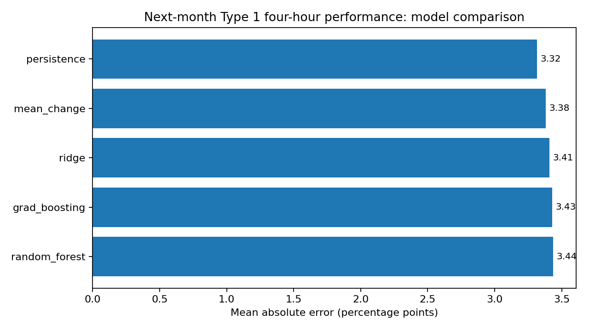
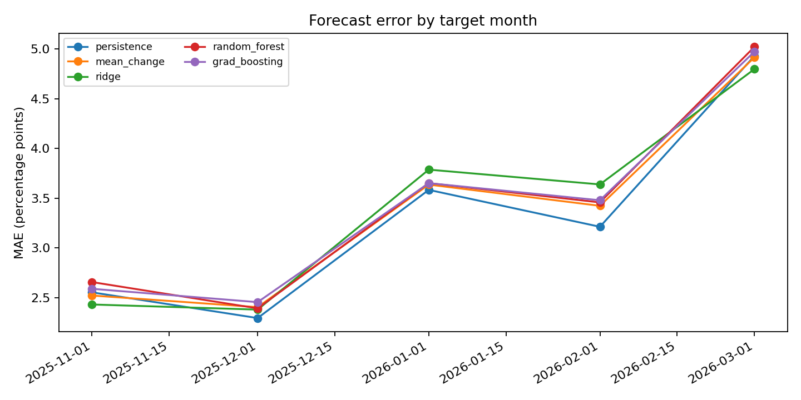
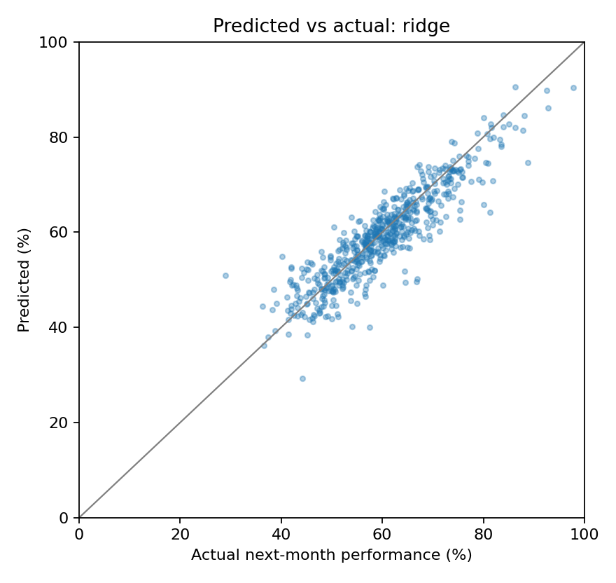

# NHS A&E forecasting: reproducible results report

## Question
Can this month's provider-level data predict the same provider's Type 1 four-hour performance in the next calendar month?

## Dataset and quality checks
- Provider-month rows after national TOTAL rows were excluded: **1,987**.
- Months present: **10** (2025-05, 2025-06, 2025-07, 2025-09, 2025-10, 2025-11, 2025-12, 2026-01, 2026-02, 2026-03).
- Trust-month modelling pairs: **968**. Only consecutive calendar months are paired.
- Missing cells in the loaded table: **0**. No missing values were imputed.
- Exact duplicate rows in the loaded table: **0**. No duplicates were silently removed.
- Data quality details: see `data_quality_report.csv`.
- Official source: [NHS England Digital — A&E Attendances and Emergency Admissions](https://digital.nhs.uk/data-and-information/publications/statistical/nhse-ae-attendances-and-emergency-admissions).

## Evaluation design
An expanding-window walk-forward evaluation trains only on origin months earlier than the month being forecast. All models use identical test rows. The models predict the change from current performance; persistence predicts no change. Metrics are shown overall and by target month.

## Results
| Model | MAE (percentage points) | RMSE (percentage points) | Predictions | MAE change vs persistence |
|---|---:|---:|---:|---:|
| persistence | 3.315 | 4.497 | 605 | +0.00% |
| mean_change | 3.381 | 4.550 | 605 | +1.98% |
| ridge | 3.408 | 4.574 | 605 | +2.78% |
| grad_boosting | 3.430 | 4.574 | 605 | +3.46% |
| random_forest | 3.437 | 4.573 | 605 | +3.66% |

The lowest overall MAE in this run is **persistence** (3.315 percentage points). The best machine-learning model is **ridge**, with an MAE change of **+2.78%** relative to persistence (negative means better; positive means worse). The persistence baseline MAE is 3.315 percentage points.

## Interpretation
The baseline comparison is essential: a more complex model is useful only if it improves on a credible simple forecast. If persistence wins, current performance is a strong short-term predictor and the extra features/models did not add enough signal in this dataset. Check `metrics_by_month.csv` before drawing conclusions; a pooled metric can hide month-to-month variation.

### Why might machine learning underperform?
Persistence already captures continuity in trust-level performance. This short, gappy dataset gives models few time steps from which to learn changing patterns, and the engineered features may add little signal beyond current performance. National conditions can also shift many trusts together. `monthly_change_diagnostic.csv` compares persistence with a hindsight-only adjustment using the realised average change across providers in each target month. The average month-specific persistence MAE was 3.315 percentage points; after this adjustment it was 2.731 points. This is **not a valid forecast** because the realised month-level change is unknown at forecast time; it only diagnoses how much common movement contributed to error.

## Limitations and assumptions
- The available dataset covers only 10 months and has calendar gaps; only 5 forecast months are evaluated.
- Trusts within the same target month share national conditions, so 605 trust-level predictions (if applicable) are not equivalent to hundreds of independent temporal tests.
- The performance measure is calculated from the selected Type 1 attendance and booked-appointment columns. It should be reconciled with the relevant NHS England definition and headline figures before being described as an official measure.
- The feature `perf_vs_region` uses contemporaneous region-level data. This is available only if the corresponding month's provider data would have been published at the forecast origin; publication timing must be checked for any operational use.
- Forecasts are evaluated as raw model outputs. Predictions outside [0, 1] are counted in the output diagnostics rather than silently clipped.
- This is retrospective research, not a validated operational, clinical or capacity-planning tool. It does not establish causality or prove that acting on a forecast improves patient outcomes.

## Reproducibility
Run `python -m src.train` from the project root. The command regenerates the quality report, predictions, overall and month-level metrics, the hindsight diagnostic, charts and this report. Run `python -m pytest -q` to execute the test suite.
